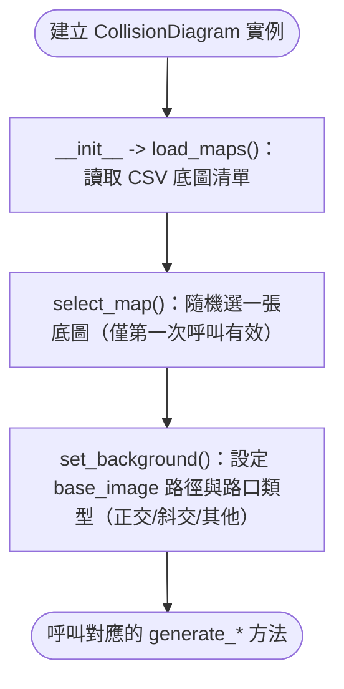
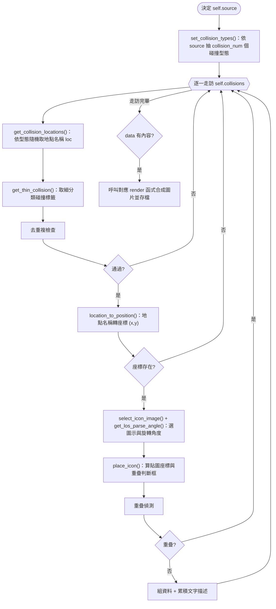
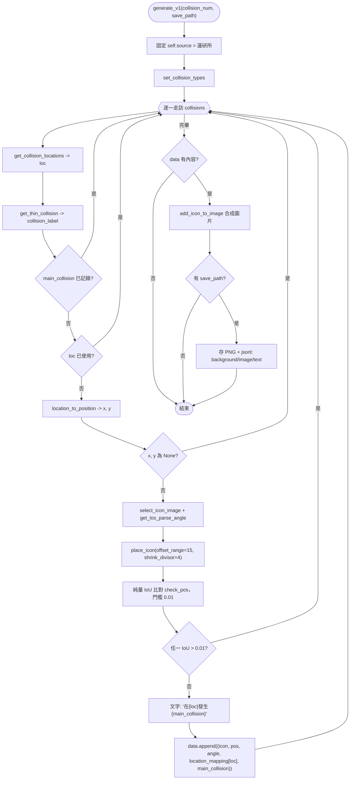
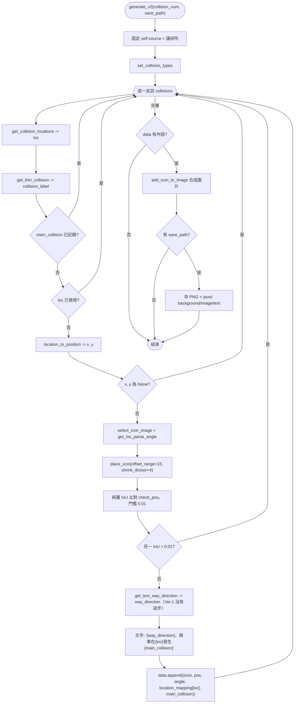
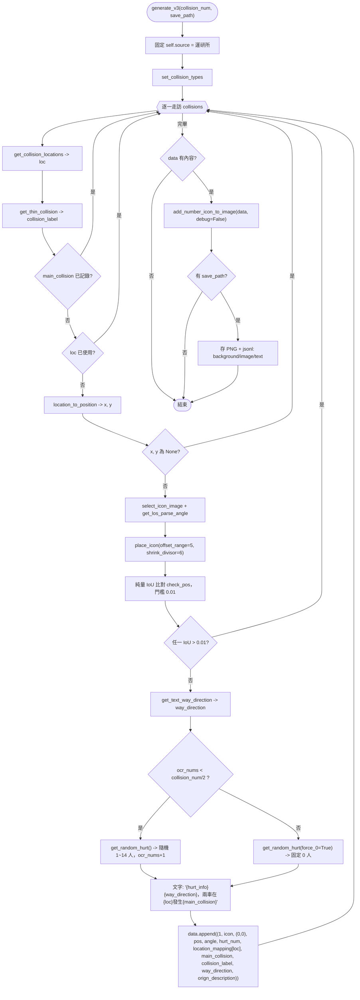
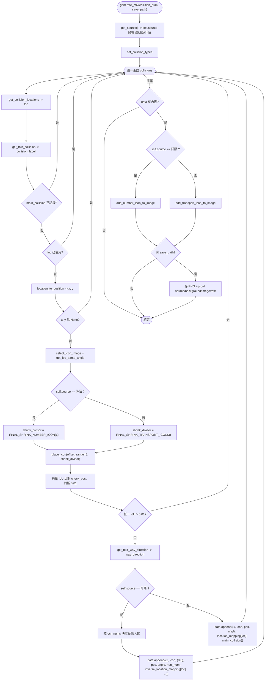
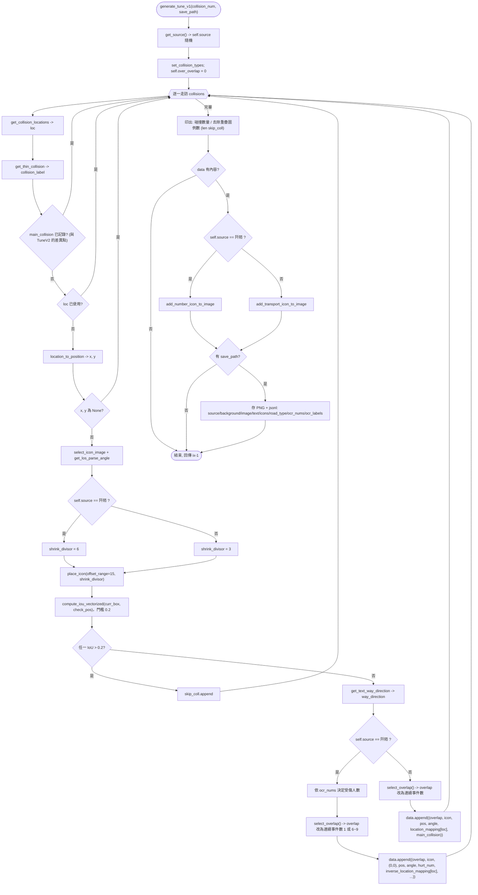
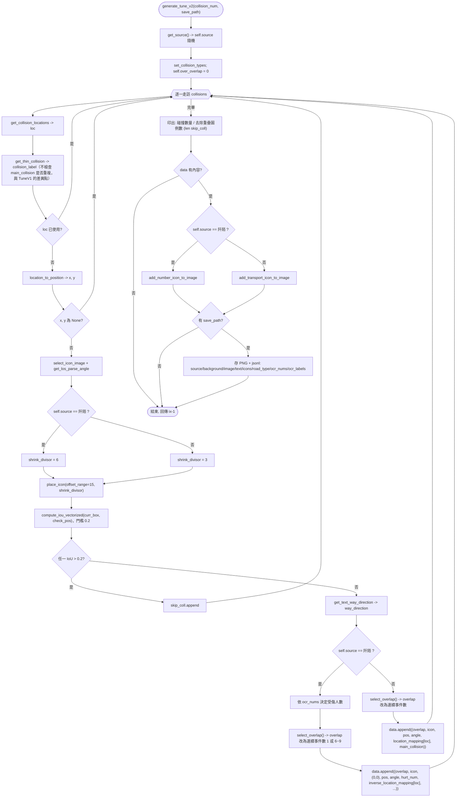
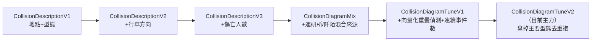

# `utils/ds_utils/generators/` 子類別流程與差異說明

`utils/ds_utils/generators/` 底下的 6 個類別都繼承自 `utils/ds_utils/base.py` 的
`CollisionDiagramBase`，各自只實作一個 `generate_*` 方法，代表一個歷史上的資料格式迭代版本。
`utils/ds_utils/facade.py` 的 `CollisionDiagram` 用多重繼承把全部 6 個版本合併回同一個名稱，
供 `make_data.py`（`--generator` 參數）等既有程式碼使用；也可以直接從
`utils.ds_utils.generators` import 單一版本的子類別。

## 總覽比較表

| 類別 | 方法 | 支援來源 | 去重複邏輯 | 重疊偵測 | `offset_range` | `shrink_divisor` | render 函式 | 連續事件數疊圖 |
|---|---|---|---|---|---|---|---|---|
| `CollisionDescriptionV1` | `generate_v1` | 僅運研所 | 地點 + 主要型態 | 純量 IoU，門檻 0.01 | 15 | `FINAL_SHRINK_ICON`（4） | `add_icon_to_image` | 無 |
| `CollisionDescriptionV2` | `generate_v2` | 僅運研所 | 地點 + 主要型態 | 純量 IoU，門檻 0.01 | 15 | `FINAL_SHRINK_ICON`（4） | `add_icon_to_image` | 無 |
| `CollisionDescriptionV3` | `generate_v3` | 僅運研所 | 地點 + 主要型態 | 純量 IoU，門檻 0.01 | 5 | `FINAL_SHRINK_NUMBER_ICON`（6） | `add_number_icon_to_image` | 無（固定傳 `overlap=1`） |
| `CollisionDiagramMix` | `generate_mix` | 運研所／阡陌隨機 | 地點 + 主要型態 | 純量 IoU，門檻 0.01 | 5 | 依 `self.source` 動態決定 | 依 `self.source` 選 `add_number_icon_to_image` 或 `add_transport_icon_to_image` | 無（固定傳 `overlap=1`） |
| `CollisionDiagramTuneV1` | `generate_tune_v1` | 運研所／阡陌隨機 | 地點 + 主要型態 | 向量化 IoU，門檻 0.2 | 15 | 依 `self.source` 動態決定 | 同上 | 有（`select_overlap()`） |
| `CollisionDiagramTuneV2` | `generate_tune_v2` | 運研所／阡陌隨機 | **僅地點**（不去重複主要型態） | 向量化 IoU，門檻 0.2 | 15 | 依 `self.source` 動態決定 | 同上 | 有（`select_overlap()`） |

**JSONL 輸出欄位**：
- `CollisionDescriptionV1`/`V2`：`background`、`image`、`text`
- `CollisionDescriptionV3`：`background`、`image`、`text`
- `CollisionDiagramMix`：`source`、`background`、`image`、`text`
- `CollisionDiagramTuneV1`/`TuneV2`：`source`、`background`、`image`、`text`、`icons`、`road_type`、`ocr_nums`、`ocr_labels`

## 共用基底流程（`CollisionDiagramBase`）

所有 `generate_*` 方法開始前，driver 端（`make_data.py` 或測試腳本）都會先做這幾步，才呼叫
`generate_*`：

`generate_*` 方法內部共用的每一輪迴圈邏輯，抽象後長這樣（各版本的差異點見下方個別流程圖）：

---

## `CollisionDescriptionV1`（肇事型態描述 Ver.1）

最早期版本：只標註「在哪個地點發生什麼肇事類型」，不含行車方向、不含傷亡人數。固定使用運研所詞彙。

**重點**：資料 tuple 最簡單（5 欄，無 overlap 欄位），文字描述只有「在哪裡發生什麼型態」。

---

## `CollisionDescriptionV2`（肇事型態描述 Ver.2）

在 Ver.1 基礎上，多呼叫一次 `get_text_way_direction()` 加上行車方向描述；其餘流程與 Ver.1 完全相同。

**與 Ver.1 的唯一差異**：多了 `get_text_way_direction()` 這一步，文字描述多了行車方向。資料
tuple 結構與 render 函式（`add_icon_to_image`）跟 Ver.1 相同。

---

## `CollisionDescriptionV3`（肇事型態描述 Ver.3）

在 Ver.2 基礎上再加上傷亡人數：每張圖大約一半的圖示會標註受傷人數（`ocr_nums < collision_num/2`
時才給非零人數，其餘固定 0）。改用 `add_number_icon_to_image` 繪製（會在圖示上畫數字），因此
`shrink_divisor`/`offset_range` 都跟 Ver.1/2 不同。

**重點**：資料 tuple 開頭固定塞 `1`（overlap 欄位，代表不疊貼——這個版本沒有連續事件數的
概念，純粹是為了配合 `add_number_icon_to_image` 統一後的資料格式）。JSONL 輸出欄位跟
Ver.1/2 一樣簡單（沒有 `source`/`icons`/`road_type` 等欄位），因為固定只用運研所。

---

## `CollisionDiagramMix`（運研所／阡陌混合來源）

第一個支援「阡陌」詞彙的版本。整張圖開始前用 `get_source()` 隨機決定 `self.source`，之後兩種
來源在迴圈中段分岔：阡陌分支比照 Ver.3 加傷亡人數、運研所分支比照 Ver.2 只加行車方向。

**重點**：`self.source` 在**整張圖生成前只決定一次**（不是每個碰撞各自決定），所以同一張圖
裡的所有圖示都是同一套詞彙。`shrink_divisor`/render 函式依 source 分岔，但兩者的資料 tuple
都固定帶 `overlap=1`（這個版本還沒有連續事件數功能）。JSONL 多了 `source` 欄位。

---

## `CollisionDiagramTuneV1`

在 `Mix` 基礎上，把重疊偵測從「純量逐一比對、門檻 0.01」換成「向量化 IoU、門檻 0.2」（效能較好，
且門檻放寬到 0.2，允許一定程度的框重疊仍算「沒有衝突」），並新增「連續事件數」疊圖功能
（`select_overlap()`：同一個地點的圖示有機率沿對角線疊貼 6~9 次，代表多起連續事故）。
**跟 `TuneV2` 唯一的差異**是這個版本仍保留「主要型態去重複」（`record_main_collisions`）。

**重點**：
- 重疊偵測改用 `compute_iou_vectorized`，一次跟 `check_pos` 裡所有框比較（效能較好），且門檻
  放寬到 0.2。
- `select_overlap()` 把原本代表「是否重疊」的 `overlap` 變數重新賦值成「連續事件數」
  （1 表示不疊貼，6~9 表示要疊貼幾次），交給 render 函式畫出對角線疊貼效果。
- 仍保留 `record_main_collisions` 去重複（跟 `Description*`/`Mix` 一致）。
- JSONL 多了 `icons`（實際成功放置的圖示數）、`road_type`、`ocr_nums`、`ocr_labels`。
- 方法有回傳值 `ix - 1`（實際放置數量），其餘版本都沒有回傳值。

---

## `CollisionDiagramTuneV2`（目前主力版本，`make_data.py` 預設使用）

流程與 `TuneV1` **完全相同**，唯一差異是迴圈裡**沒有** `main_collision 已記錄過就跳過` 這個
檢查，所以同一張圖可以出現同一種主要肇事型態多次——這是刻意拿掉去重複限制以增加資料多樣性，
不是遺漏。

**與 `TuneV1` 的唯一差異**：拿掉了 `main_collision` 去重複檢查（上圖的 E 步驟），其餘完全相同
（重疊偵測、連續事件數疊圖、JSONL 欄位、回傳值都一樣）。

---

## 版本演進脈絡（由舊到新）

## 已知問題與注意事項

- `CollisionDescriptionV1`/`V2`/`V3` 只支援運研所詞彙（`self.source` 在方法內固定寫死），
  呼叫端不需要（也不應該）自己設定 `self.source`。
- `place_icon()` 的 `shrink_divisor` 參數**必須**跟該版本最終會呼叫的 render 函式一致，兩者
  對不上會導致重疊偵測失真（2026-07-24 修過的既有 bug，詳見 `markdown/NEED.md`）。
- `CollisionDiagramMix`/`TuneV1`/`TuneV2` 的 `self.source` 是「整張圖決定一次」，不是每個
  碰撞各自隨機——同一張圖裡的圖示一定同屬一套詞彙。
- 若要驗證任一版本改動後是否還能正常運作，用 `python make_test_data.py` 逐一測試 6 個版本，
  不要只測自己改的那一個（`CollisionDiagramBase` 的共用方法一改，全部版本都會受影響）。
